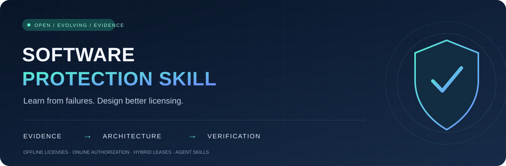

<div align="center">

**简体中文** · [English](README.en.md)



# 🛡️ 软件保护与授权设计 Skill

**从公开破解案例，反推更可靠的授权设计。**

让 AI 助手告诉你：哪里值得保护、授权怎么写、方案如何落地，以及怎样验证。

[](LICENSE)
[](https://agentskills.io/specification)
[](#-持续更新)

[开始使用](#-开始使用) · [失效模式](skills/software-protection/references/failure-patterns.md) · [案例索引](docs/cases.md) · [贡献案例](CONTRIBUTING.md) · [GitHub 入门](docs/github-guide.md)

</div>

---

## ✨ 这个项目解决什么

“加一个激活窗口”“换成 RSA”“套一层壳”，都不足以回答软件到底保护了什么。

本项目把公开分析中的**失效条件 → 防御措施 → 验收用例 → 剩余风险**整理为可复用的 Agent Skill。你可以让助手只给完整方案，也可以在具备项目与工具权限时协助接入和加固。

| 🔍 先找重点 | 🧭 再选架构 | 🛠️ 最后落地 |
| --- | --- | --- |
| 密钥、核心逻辑、授权入口、资源、API、发布与更新链 | 离线签名许可证、联网授权、混合短期租约 | 接入位置、声明格式、设备与席位规则、运维迁移、验收清单 |

**不绑定授权厂商、操作系统或 AI 平台。**使用标准 `SKILL.md`；实际可用性取决于助手是否支持技能加载，以及它拥有的文件、构建与运行权限。没有源码的程序先评估可改造性。

## 🚀 开始使用

1. 下载本仓库：点击 **Code → Download ZIP**，或运行：

```bash
git clone https://github.com/MuCheng2007/software-protection-skill.git
```

2. 将整个 `skills/software-protection/` 文件夹复制到你的助手支持的技能目录，保留 `references/`。Codex 的项目级目录示例是 `.agents/skills/software-protection/`；其他助手按各自文档导入。
3. 新会话中明确要求使用 `software-protection`。如果助手没有技能加载功能，可以让它阅读 `SKILL.md` 和相关引用，再提供项目材料。

**先要方案：**

```text
使用 software-protection 分析这个项目。
列出最值得保护的位置，比较本地、联网和混合授权，
推荐一种方案，给出接入、发卡、撤销、换机、异常恢复与验收步骤。
先提供方案，不修改代码。
```

**检查现有保护：**

```text
使用 software-protection 检查现有授权链。
重点看公钥替换、验签结果篡改、伪造响应、缓存恢复、更新入口，
以及移除授权调用后业务是否仍能运行。
每个结论给出项目证据、修复方法、测试方式和剩余风险。
```

**实施接入：**

```text
使用 software-protection，给这个自有源码项目接入离线签名许可证。
要求到期时间、最多两台设备的管理方案和合法换机流程。
说明纯离线能实现到什么程度，实施可完成的部分并验证行为。
```

项目级技能目录依据：[OpenAI 官方说明](https://developers.openai.com/blog/skills-agents-sdk)。通用格式：[Agent Skills 规范](https://agentskills.io/specification)。

## 🧩 目前覆盖的 11 类失效模式

| ID | 常见失效点 | 要回答的防御问题 |
| --- | --- | --- |
| F01 | 密码执行链、公钥或结果被改 | 验证器被改后，实际能力还由谁控制？ |
| F02 | 伪造服务、替换授权配置 | 响应是否绑定正确发行者、产品、设备与权限？ |
| F03 | 可逆校验与发卡规则泄漏 | 客户端是否具有自行发卡的能力？ |
| F04 | 打包、字节码、资源误作保密 | 发布包到底交给用户哪些秘密？ |
| F05 | 加载与更新链完整性缺口 | 验证的文件是否就是执行的文件？ |
| F06 | 多处检查共享可改状态 | 多层保护是否仍依赖一个布尔值？ |
| F07 | 后台权限与字段约束不足 | 服务端是否独立执行租户、权限和状态检查？ |
| F08 | 试用、心跳、席位与时间 | 并发、断网、撤销和回拨如何处理？ |
| F09 | 启动、导入或迁移直接信任缓存 | 恢复授权时是否重新验证？ |
| F10 | 算法参数强度不合格 | 实际密钥、参数和签名方案是否合理？ |
| F11 | 宏/脚本授权模块被删除 | 删除授权调用后，业务是否仍独立可用？ |

完整规则与测试：[failure-patterns.md](skills/software-protection/references/failure-patterns.md)。F08 是工程回归维度，当前案例不足以证明其流行程度。

## 📚 案例与证据

首版记录 **20 条候选资料、11 类失效模式**。候选包含实践主张、教学样例、历史补充和排除记录，**不等于 20 款已确认破解的软件**。来源包括看雪、飘云阁与吾爱汇编；吾爱破解原站仍有覆盖缺口。

案例按原始发表日期与读取范围记录，保留来源、前置条件和局限。当前没有第三方样本的独立复现，不将作者声称成功写成已验证事实，也不据此断言产品当前版本仍存在缺陷。

➡️ [阅读案例索引](docs/cases.md) · [结构化资料](skills/software-protection/references/forum-cases.json) · [飘云阁补查](docs/research/chinapyg-supplement-report.md)

## 🔄 持续更新

**本项目将持续收录更多公开的软件授权失效、篡改与保护案例，帮助开发者理解自己的授权应怎样设计、软件应怎样保护。**

更新流程：提交公开来源 → 核对日期和证据 → 提炼失效原因 → 补充防御及验收 → 审阅后合并。欢迎补充成功的防护、修复后的验证结果和反例，避免只收集失败故事。

- 新案例通过 [Issues](https://github.com/MuCheng2007/software-protection-skill/issues) 提交，按模板提供证据。
- 规则与材料改进通过 Pull Request 提交，先运行本地检查。
- 维护进度写入 [更新记录](CHANGELOG.md)，计划见 [路线图](ROADMAP.md)。采用人工审阅，不承诺固定频率或后台自动全站抓取。

## 🧠 设计边界

签名证明授权来自谁，不保证被修改的客户端执行校验；联网保护真正受控的服务端能力，单独返回 `true` 仍然不够。混淆、原生编译和完整性措施可以提高成本，不能承诺绝对防破解。

本项目提供设计与实施指导，不是现成授权服务器或通用 EXE 加壳器。没有目标程序时输出参考方案；没有实际运行时不声称通过防护测试。用于开发者自有或授权目标的保护改进，不收录可直接使用的第三方激活码、注册机或破解附件。

## 🧰 仓库导航

```text
skills/software-protection/  技能正文与按需加载的参考
docs/                       案例索引、调研范围、使用说明
assets/                     仓库展示图
scripts/validate.py         无第三方依赖的结构与证据检查
.github/                    贡献模板与自动检查
```

```bash
python scripts/validate.py
```

检查覆盖结构、内部引用、案例字段与模式映射，不证明目标软件安全。

## 📄 开源与来源

原创技能、脚本与图形采用 [MIT License](LICENSE)，欢迎使用、修改和分享。第三方帖子、商标及链接页面的权利仍归原权利人；本仓库仅保存简短原创摘要与引用，来源说明见 [NOTICE](NOTICE)。
